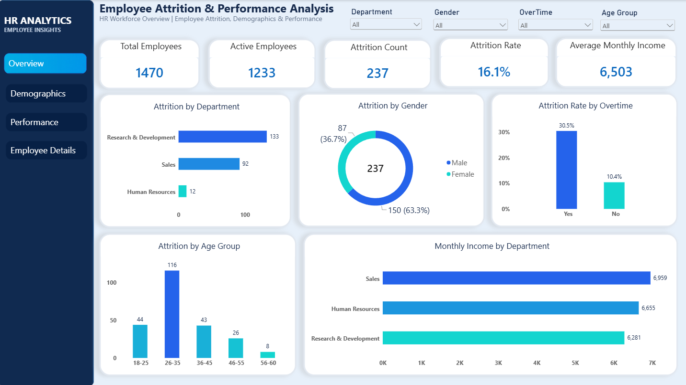
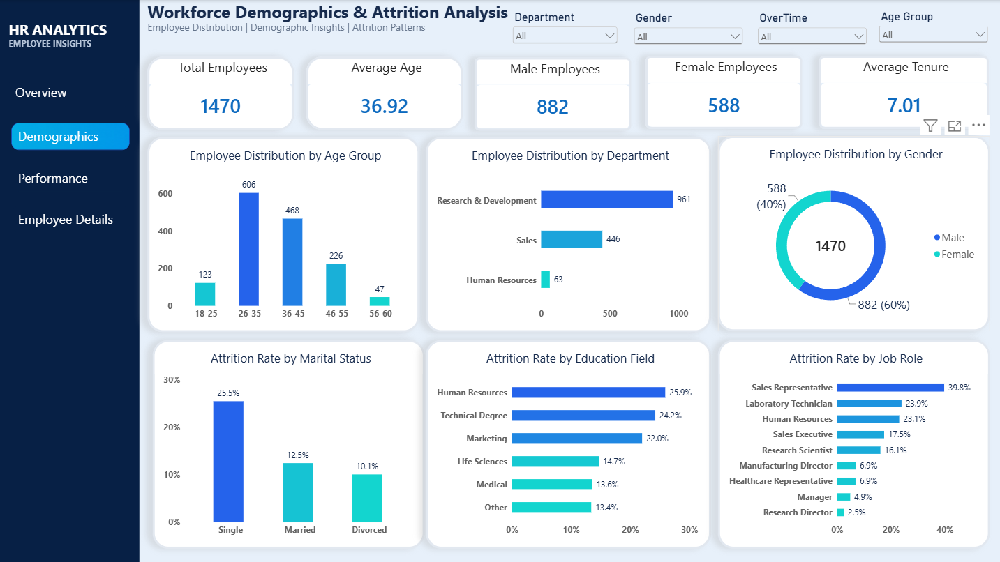
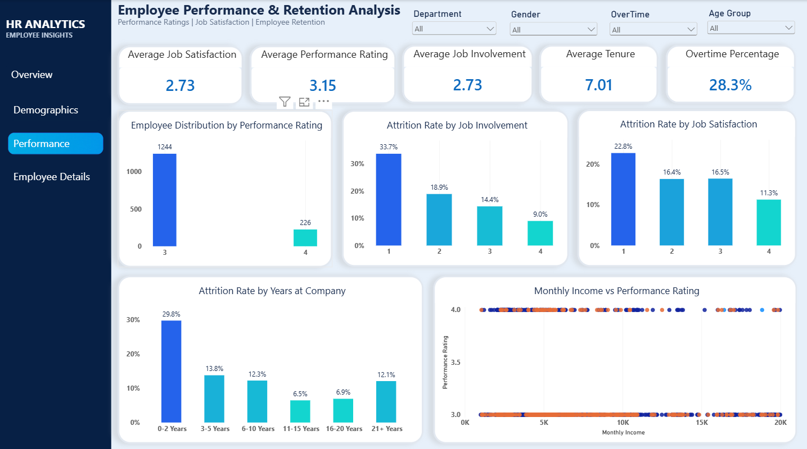

# Employee Attrition and Performance Analysis

### TCS iON Industry Project | Microsoft Power BI

An interactive, multi-page HR analytics dashboard developed using Microsoft Power BI to analyse employee attrition, workforce demographics, employee performance, job satisfaction, and retention-related patterns.

---

## Table of Contents

1. [Project Overview](#project-overview)
2. [Project Objectives](#project-objectives)
3. [Dataset Information](#dataset-information)
4. [Tools and Technologies](#tools-and-technologies)
5. [Dashboard Overview](#dashboard-overview)
6. [Interactive Features](#interactive-dashboard-features)
7. [Key Analytical Findings](#key-analytical-findings)
8. [DAX Measures](#dax-measures)
9. [Testing and Validation](#testing-and-validation)
10. [Project Structure](#project-structure)
11. [Project Demonstration Video](#project-demonstration-video)
12. [How to Access the Project](#how-to-access-the-project)
13. [Project Deliverables](#project-deliverables)
14. [Conclusion](#conclusion)
15. [Author](#author)

---

## Project Overview

Employee attrition is an important challenge for organizations because employee turnover can affect workforce stability, productivity, recruitment costs, and long-term planning.

This project focuses on analysing employee attrition and performance indicators using the IBM HR Analytics Employee Attrition & Performance dataset.

The project transforms raw employee data into an interactive Power BI dashboard that helps explore workforce demographics, identify attrition patterns, examine job-related factors, and understand employee performance indicators.

| Project Detail | Information |
|---|---|
| Project Title | Employee Attrition and Performance Analysis |
| Project Provider | TCS iON |
| Project Type | Industry Project |
| Technology | Microsoft Power BI |
| Dataset | IBM HR Analytics Employee Attrition & Performance |
| Data Analysis | Power Query and DAX |
| Visualization | Interactive Power BI Dashboard |

---

## Project Objectives

- Analyse overall employee attrition and workforce distribution.
- Examine employee demographics such as age, gender, department, and marital status.
- Identify attrition patterns across departments, job roles, and education fields.
- Analyse job satisfaction, job involvement, and performance ratings.
- Explore the relationship between monthly income and performance rating.
- Develop an interactive dashboard to support HR-related data exploration.
- Present meaningful insights through KPIs and visualizations.

---

## Dataset Information

The project uses the **IBM HR Analytics Employee Attrition & Performance** dataset.

| Dataset Detail | Information |
|---|---:|
| Total Records | 1,470 |
| Total Columns | 35 |
| Attrition - Yes | 237 |
| Attrition - No | 1,233 |
| Average Age | 36.92 |
| Average Monthly Income | 6,502.93 Dataset Units |
| Data Format | CSV |
| Data Source | Kaggle |

### Data Preparation

The dataset was reviewed and prepared before dashboard development.

Key activities included:

- Data inspection and validation.
- Checking missing values and duplicate records.
- Reviewing categorical and numerical columns.
- Validating Attrition column values.
- Preparing fields for analysis and visualization.
- Creating calculated measures using DAX.

**Dataset Disclaimer:** This project uses the publicly available IBM HR Analytics sample dataset. It does not contain actual TCS employee records or confidential organizational data. Monthly income values are presented in the original dataset units; no currency denomination is assumed.

**Dataset Source:** [IBM HR Analytics Employee Attrition & Performance Dataset - Kaggle](https://www.kaggle.com/datasets/pavansubhasht/ibm-hr-analytics-attrition-dataset)

---

## Tools and Technologies

| Tool / Technology | Purpose |
|---|---|
| Microsoft Power BI | Dashboard development and data visualization |
| Power Query | Data cleaning and transformation |
| DAX | Calculated measures and KPIs |
| Microsoft Excel | Data inspection and validation |
| CSV | Dataset storage |
| GitHub | Project version control and documentation |
| Google Drive | Hosting the project demonstration video |

---

## Dashboard Overview

The project contains four interactive dashboard pages.

### 1. HR Overview Dashboard

Provides a high-level summary of the employee workforce and attrition situation.

**Key Performance Indicators:**
- Total Employees
- Active Employees
- Attrition Count
- Attrition Rate
- Average Monthly Income

**Visualizations:**
- Attrition by Department
- Attrition by Gender
- Attrition by Overtime
- Attrition by Age Group
- Average Monthly Income by Department

**Dashboard Preview:**



---

### 2. Demographics and Attrition Dashboard

Focuses on employee demographics and attrition patterns across different workforce categories.

**Key Performance Indicators:**
- Total Employees
- Average Age
- Male Employees
- Female Employees
- Average Tenure

**Visualizations:**
- Employee Distribution by Age Group
- Employee Distribution by Department
- Employee Distribution by Gender
- Attrition Rate by Marital Status
- Attrition Rate by Education Field
- Attrition Rate by Job Role

**Dashboard Preview:**



---

### 3. Performance and Retention Dashboard

Examines employee performance indicators and job-related factors associated with attrition.

**Key Performance Indicators:**
- Average Job Satisfaction
- Average Performance Rating
- Average Job Involvement
- Average Tenure
- Overtime Percentage

**Visualizations:**
- Employee Distribution by Performance Rating
- Attrition Rate by Job Involvement
- Attrition Rate by Job Satisfaction
- Attrition Rate by Years at Company
- Monthly Income vs Performance Rating (Scatter Chart)

**Dashboard Preview:**



---

### 4. Employee Details and Workforce Insights Dashboard

Provides an employee-level view through a department-based drill-through feature.

**Employee Details Include:**
- Employee Number
- Age
- Gender
- Department
- Job Role
- Monthly Income
- Overtime
- Job Satisfaction
- Performance Rating
- Years at Company
- Attrition Status

Users can navigate from department-level analysis to detailed employee records using the drill-through functionality.

**Dashboard Preview:**


---

## Interactive Dashboard Features

- **Synchronized Slicers:** Department, Gender, Overtime, and Age Group filters are synchronized across the first three dashboard pages.
- **Cross-Filtering:** Selecting chart elements updates related visualizations.
- **Drill-Through:** Navigate from department-level analysis to detailed employee records.
- **Page Navigation:** Move between dashboard pages using navigation controls.
- **KPI Cards:** Display important workforce metrics.
- **Scatter Analysis:** Explore monthly income against performance ratings.
- **Interactive Visualizations:** Explore employee data through charts, filters, and visual interactions.

---

## Key Analytical Findings

The analysis of the sample dataset highlights the following observations:

- The dataset contains 1,470 employee records.
- A total of 237 employees have an Attrition status of Yes.
- The overall attrition rate is approximately 16.12%.
- The Research & Development department contains 961 employees.
- The Sales department contains 446 employees.
- The Human Resources department contains 63 employees.
- Average monthly income is approximately 6,502.93 dataset units.

These observations describe the sample dataset and should not be interpreted as findings about TCS or any other actual organization.

---

## DAX Measures

DAX measures were created to calculate important workforce metrics and analytical indicators.

Examples include:

- Total Employees
- Active Employees
- Attrition Count
- Attrition Rate
- Average Monthly Income
- Average Age
- Average Tenure
- Average Job Satisfaction
- Average Performance Rating
- Average Job Involvement
- Overtime Percentage

These measures are used in KPI cards and visualizations throughout the dashboard.

---

## Testing and Validation

The completed Power BI dashboard was tested to verify its functionality and analytical outputs.

### Testing Summary

| Testing Detail | Result |
|---|---:|
| Total Test Cases | 20 |
| Passed Test Cases | 20 |
| Failed Test Cases | 0 |
| Defects Reported | 0 |
| Overall Status | Passed |

Testing covered:

- Dashboard page navigation.
- KPI calculations and displayed values.
- Department-wise employee counts.
- Slicer functionality.
- Synchronized slicers.
- Chart interactions.
- Drill-through functionality.
- Employee-level details.
- Dashboard reopening and validation.

The unit test results and defect log are included in the project deliverables.

---

## Project Structure

```text
Employee-Attrition-Performance-Analysis/
│
├── README.md
│
├── Dashboard/
│   └── TCS_Employee_Attrition_Performance_Analysis.pbix
│
├── Dataset/
│   └── IBM_HR_Analytics_Employee_Attrition_Performance.csv
│
├── Documentation/
│   ├── TCS_Employee_Attrition_Performance_Analysis_Project_Report.pdf
│   └── TCS_Employee_Attrition_Performance_Analysis_Project_Report.docx
│
├── Testing/
│   └── TCS_Employee_Attrition_Unit_Test_Results_and_Defect_Log.xlsx
│
├── Screenshots/
│   ├── HR_Overview.png
│   ├── Demographics_Attrition.png
│   ├── Performance_Retention.png
│   └── Employee_Details.png
│
└── Video/
    └── Demonstration video hosted on Google Drive
```

---

## Project Demonstration Video

The complete project demonstration is available on Google Drive.

The video demonstrates:

- Introduction to the project.
- HR Overview dashboard.
- Demographics and Attrition analysis.
- Performance and Retention analysis.
- Interactive slicers and dashboard navigation.
- Department-based drill-through.
- Employee-level details and insights.

**[▶ Watch the Complete Project Demonstration Video](https://drive.google.com/file/d/1xhqzjxwYLQCCptfglFZWeIVbqibtmBDB/view?usp=sharing)**

*Video access is available to anyone with the link.*

---

## How to Access the Project

1. Clone or download this GitHub repository.
2. Open the `Dashboard` folder.
3. Download `TCS_Employee_Attrition_Performance_Analysis.pbix`.
4. Open the PBIX file using Microsoft Power BI Desktop.
5. Interact with the dashboard using slicers, charts, navigation, and drill-through features.

**Note:** Microsoft Power BI Desktop is required to open and interact with the PBIX file.

---

## Project Deliverables

The project includes the following deliverables:

1. Power BI Dashboard (.pbix)
2. Project Report (PDF and DOCX)
3. Unit Test Results and Defect Log (Excel)
4. Dataset (CSV)
5. Dashboard Screenshots
6. Project Demonstration Video (Google Drive)

---

## Conclusion

This project demonstrates the application of data analytics and business intelligence techniques to employee attrition and performance analysis.

By combining data preparation, DAX calculations, interactive visualizations, synchronized slicers, and drill-through functionality, the dashboard provides a structured way to explore workforce patterns and employee-related indicators.

The project also provides practical experience in data cleaning, analytical thinking, dashboard development, testing, and presenting data-driven findings.

---

## Author

**Sachin Jitendra Singh**

Bachelor of Science in Information Technology (B.Sc. IT)  

**GitHub Repository:** [Employee Attrition and Performance Analysis](https://github.com/Sachin-tool/Employee-Attrition-Performance-Analysis)

**Project Provider:** TCS iON

---

*This project was developed for academic and learning purposes using a publicly available sample HR analytics dataset.*
