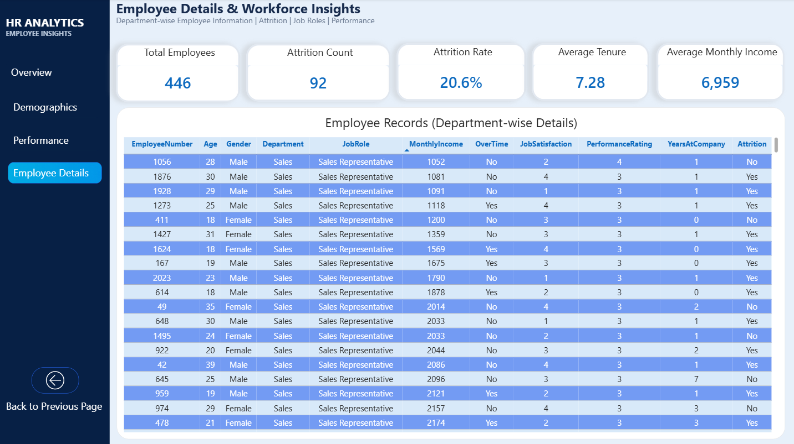

# Employee Attrition and Performance Analysis

An interactive HR Analytics dashboard developed using **Microsoft Power BI** to analyse employee attrition, workforce demographics, job satisfaction, employee performance, and retention patterns.

## Project Overview

This project focuses on analysing employee-related data to identify patterns associated with employee attrition, workforce distribution, job satisfaction, and performance.

The project uses Microsoft Power BI to transform raw HR data into an interactive dashboard with KPI cards, charts, slicers, and department-level employee insights.

**Important:** This project uses the IBM HR Analytics Employee Attrition & Performance sample dataset obtained from Kaggle. It does not contain actual TCS employee records.

## Project Objectives

- Analyse overall employee attrition patterns.
- Understand workforce demographics.
- Evaluate job satisfaction and performance.
- Examine the relationship between overtime and attrition.
- Analyse department-wise employee distribution.
- Identify workforce trends through interactive dashboards.
- Present employee insights using Power BI visualisations.

## Dataset Information

| Attribute | Details |
|---|---|
| Dataset | IBM HR Analytics Employee Attrition & Performance |
| Source | Kaggle |
| Records | 1,470 |
| Columns | 35 |
| Format | CSV |
| Data Type | Sample HR analytics data |

The dataset includes employee age, gender, department, job role, monthly income, overtime, job satisfaction, performance rating, years at company, and attrition status.

**Dataset Source:** [IBM HR Analytics Employee Attrition & Performance – Kaggle](https://www.kaggle.com/datasets/pavansubhasht/ibm-hr-analytics-attrition-dataset)

## Tools and Technologies

- Microsoft Power BI Desktop
- Power Query
- DAX (Data Analysis Expressions)
- Microsoft Excel
- CSV Dataset
- GitHub

## Dashboard Pages

### 1. HR Overview

Provides a high-level summary of workforce size, employee attrition, and income distribution.

**KPI Cards:**
- Total Employees
- Active Employees
- Attrition Count
- Attrition Rate
- Average Monthly Income

**Visualisations:**
- Attrition by Department
- Attrition by Gender
- Attrition Rate by Overtime
- Attrition by Age Group
- Average Monthly Income by Department

### 2. Demographics & Attrition

Analyses employee distribution and attrition patterns across demographic and organisational categories.

**KPI Cards:**
- Total Employees
- Average Age
- Male Employees
- Female Employees
- Average Tenure

**Visualisations:**
- Employee Distribution by Age Group
- Employee Distribution by Department
- Employee Distribution by Gender
- Attrition Rate by Marital Status
- Attrition Rate by Education Field
- Attrition Rate by Job Role

### 3. Performance & Retention

Explores employee performance, satisfaction, involvement, overtime, and retention patterns.

**KPI Cards:**
- Average Job Satisfaction
- Average Performance Rating
- Average Job Involvement
- Average Tenure
- Overtime Percentage

**Visualisations:**
- Employee Distribution by Performance Rating
- Attrition Rate by Job Involvement
- Attrition Rate by Job Satisfaction
- Attrition Rate by Years at Company
- Monthly Income vs Performance Rating

### 4. Employee Details & Workforce Insights

Provides detailed employee-level information through department-based drill-through functionality.

**Features:**
- Department-wise employee records
- Employee identification and demographic details
- Monthly income and tenure details
- Job satisfaction and performance information
- Attrition status
- Department-based drill-through
- Back navigation to the previous report page

## Key Dataset Observations

- Total employees: 1,470
- Employees with attrition: 237
- Active employees: 1,233
- Overall attrition rate: 16.12%
- Average monthly income: 6,502.93 (Dataset Units)
- Average employee age: 36.92 years

These figures describe the IBM HR Analytics sample dataset, not TCS's workforce. The source data does not establish INR as the currency denomination of the MonthlyIncome field.

## Interactive Features

- Department, Gender, Overtime, and Age Group slicers
- Synchronized slicers across the main dashboard pages
- Interactive chart filtering
- Department-wise drill-through
- Employee-level detail table
- Navigation between dashboard pages
- Drill-through back navigation

## Testing Results

The dashboard was manually tested using 20 test cases.

| Testing Metric | Result |
|---|---:|
| Total Test Cases | 20 |
| Passed | 20 |
| Failed | 0 |
| Defects Reported | 0 |

Testing covered page navigation, slicers, KPI calculations, chart interactions, department drill-through, employee records, and save/reopen functionality.

The detailed Unit Test Results and Defect Log are available in the repository.

## Project Structure

```text
Employee-Attrition-Performance-Analysis/
│
├── README.md
├── Dashboard/
│   └── TCS_Employee_Attrition_Performance_Analysis.pbix
├── Dataset/
│   └── Employee_Attrition_Dataset.csv
├── Documentation/
│   ├── Project_Report.pdf
│   └── Project_Report.docx
├── Testing/
│   └── Unit_Test_Results.xlsx
├── Screenshots/
│   ├── HR_Overview.png
│   ├── Demographics_Attrition.png
│   ├── Performance_Retention.png
│   └── Employee_Details.png
└── Video/
    └── Dashboard_Demonstration.mp4
```

## How to Use

1. Download the Power BI `.pbix` file from the Dashboard folder.
2. Download the source CSV file from the Dataset folder.
3. Install Microsoft Power BI Desktop.
4. Open the `.pbix` file.
5. If Power BI requests the source CSV location, update the data source path.
6. Refresh the data if required.
7. Explore the dashboard using its slicers, charts, and drill-through features.

## Project Deliverables

- Interactive Power BI Dashboard
- Project Report (PDF)
- Editable Project Report (Word)
- Unit Test Results and Defect Log
- Source Dataset
- Dashboard Screenshots
- Application Execution Video
- Five-page Project Summary PDF

## Documentation

- [Project Report (PDF)](Documentation/Project_Report.pdf)
- [Project Report (Word)](Documentation/Project_Report.docx)
- [Unit Test Results and Defect Log](Testing/Unit_Test_Results.xlsx)

## Dashboard Preview

### 1. HR Overview


### 2. Demographics & Attrition


### 3. Performance & Retention


### 4. Employee Details & Workforce Insights



## Application Execution Video

The dashboard demonstration video will be available here:

[Dashboard Demonstration Video](Video/Dashboard_Demonstration.mp4)

## Author

**Sachin Singh**

B.Sc. Information Technology Student

GitHub: [Sachin-tool](https://github.com/Sachin-tool)

## Project Information

This project was developed as part of the TCS iON Industry Project titled **Employee Attrition and Performance Analysis**.

The project is intended for academic and learning purposes. All findings and recommendations are based on the supplied IBM HR Analytics sample dataset and should not be interpreted as actual TCS workforce insights.
